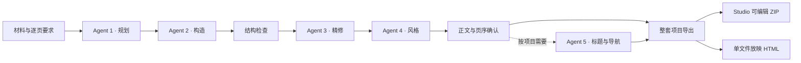

# 页序 · Yexu

**网页演示流水线 · Web Presentation Pipeline**

[简体中文](#中文) ｜ [English](#english)

## 中文

**从研究材料、课件提纲或项目记录出发，做成可以继续编辑、统一视觉并离线放映的网页演示。**

[在线体验 Engagement 示例](https://jhchen6393.github.io/ppt-center/) · [DSH 插件与兼容性](https://jhchen6393.github.io/ppt-center/dsh.html) · [下载可编辑示例](https://jhchen6393.github.io/ppt-center/assets/engagement-demo.studio.zip)

### 适合哪些场景

| 场景 | 可以怎么用 |
| --- | --- |
| **科研汇报与答辩** | 把研究问题、方法和证据组织成连续的讲述，临时补数据时修改对应的卡片。 |
| **课程与知识讲解** | 用对照、流程和图表解释关系，把单文件放映版随课件分享。 |
| **项目评审与阶段总结** | 把进展、问题与下一步放进一套页面。汇报前可以再调页序、更新局部内容并导出。 |

### 运作原理

正文按页处理。规划先决定这一页要讲什么、从哪里读起，构造再把文字、数据和关系落实为可编辑对象。通过结构检查的页面交给精修，最后应用共同的风格。正文和页序确定后，可以按项目补齐封面、目录和章节页。

DSH 负责管理项目、批次状态和阶段交接。Agent 负责理解材料与做设计判断，本地工具负责卡片检索、几何计算、渲染、结构检查和导出。结构检查确认页面能继续编辑和加工，实际可读性还要看渲染结果。

#### 各 Agent 的设定与交付

| Agent | 读取 | 职责与判断范围 | 交付给下一步 |
| --- | --- | --- | --- |
| **1 · 规划** | 本页材料、目标、特殊要求和构图偏好 | 提炼主次、内容分组、阅读顺序和主视觉。分配画布区域、检查容量，保留卡内实现空间。 | 任务书、区块几何和分区图。 |
| **2 · 构造** | 原材料、任务书、区块和按需检索的卡片参考 | 复用、改造或自由构造模块，把内容绑定到原生文字、图表和卡片节点。核对材料事实、单位和必要限定，测量并组装整页。 | 模块化页面、卡片 ID、实际截图和结构检查结果。 |
| **3 · 精修** | 已组装页面、整页截图和目标卡片测量 | 从实际画面判断是否需要精修，处理换行、间距、对齐或卡内排列。自动模式保留页面分区与色彩；页面已经清楚时可以原样交付。 | 可追踪的局部补丁或原样交付，以及精修后的截图。 |
| **4 · 风格** | 精修底稿、页面视觉角色和所选风格包 | 把深浅卡面、强调色、文字用色和装饰映射到统一风格。保护底稿和已指定的局部效果。正文页序与标签可用于自动编排 Engagement 转场。 | 独立的页面风格层与风格预览。 |
| **5 · 标题与导航** | 已定稿正文的标题、章节归属、页序和项目风格 | 在项目层补齐封面、目录、章节页与配套转场。现有 Engagement 实现由固定页面设计和转场承载，模型负责整理标题与导航内容。 | 可随整套项目导出的特殊页和导航关系。 |

#### 为什么交付还能接着修改

- **卡片保留结构。** 文字、图形、分隔线和卡面是可定位的对象。改一个数字或调整一张卡片，可以在 Studio 对应对象上继续工作。
- **风格和正文分别保存。** 结构页保留原有内容和几何，配色、装饰等按风格层应用。Engagement 用浅色主区、深色辅助区与渐消线组织层次，演示中可看到深色区域随两页版式移动。
- **编辑和放映各有文件。** Studio 项目包用于继续修改，放映 HTML 可直接用浏览器打开，也适合在离线环境使用。

### 试用路径

1. **在线翻页。** 从校园微气候观测的布点页切到结果页，看看矩阵、说明与总结区如何重新排布。示例材料为虚构数据。 [打开在线演示](https://jhchen6393.github.io/ppt-center/)
2. **查看页面结构。** 下载 ZIP，在 PPT Studio 里打开项目，选中文字或卡片检查布局。 [下载 Studio 示例](https://jhchen6393.github.io/ppt-center/assets/engagement-demo.studio.zip)
3. **离线放映。** 双击打开播放器，然后选择本地项目 ZIP。也可以直接打开已包含示例的单文件放映版。 [下载离线播放器](https://jhchen6393.github.io/ppt-center/assets/PPT-Studio-Player.html) · [单文件放映版](https://jhchen6393.github.io/ppt-center/assets/engagement-demo.deck.html)

### 当前交付范围

| 组件 | 状态 |
| --- | --- |
| **展示站、独立播放器、可编辑示例** | 已公开，可直接体验。 |
| **DSH 桌面集成** | 已在 Windows、DSH 0.2.2-rc.3 与配套 0.8.6 运行包核对角色加载。真实双页验收中有一页跑通并完成 Studio 回读，另有一页停在任务绑定。公开安装包待新环境验收。 |
| **风格调配工作站** | 本地工具可在一张 Engagement 风格卡上调配色阶、玻璃、砂纹与线条，并在风格卡和完整风格包之间回读。模型端到端调配和生产换肤入口仍待验收。 |

[查看桌面集成说明](https://jhchen6393.github.io/ppt-center/dsh.html)

---

## English

**Yexu turns research notes, teaching outlines, and project updates into editable browser presentations.** You can revise individual cards in Studio and keep a separate HTML copy for offline playback.

[Play the English demo](https://jhchen6393.github.io/ppt-center/assets/yexu-engagement-en.deck.html) · [Download the editable English sample](https://jhchen6393.github.io/ppt-center/assets/yexu-engagement-en.studio.zip) · [Download the offline player](https://jhchen6393.github.io/ppt-center/assets/PPT-Studio-Player.html)

### What it is for

| Use case | What you can do |
| --- | --- |
| Research talks and defenses | Organize the question, method, and evidence in reading order. Update the affected card when a result changes. |
| Teaching | Use comparisons, diagrams, and sequences to explain relationships. Share a single HTML file with the class. |
| Project reviews | Bring progress, issues, and next steps into one deck. Change the order or update a local detail before presenting. |

### How it works

Material → Plan → Build → Structural check → Refine → Style → Arrange and export

Agents make content and design decisions. The desktop host routes work between stages, and local tools handle measurements, rendering, and exports. A structural check confirms that a page can continue through the workflow. Readability is assessed on the rendered page.

| Agent | Responsibility | Output |
| --- | --- | --- |
| **1 · Plan** | Identify the main point, reading order, and available space for each content group. | Page brief, regions, and layout preview. |
| **2 · Build** | Turn the brief into editable text, charts, and cards. Check the assembled page against the brief and source material. | Native page objects, stable card IDs, and a rendered preview. |
| **3 · Refine** | Review the whole slide and fix local wrapping, spacing, or alignment where needed. | A targeted patch or an unchanged handoff. |
| **4 · Style** | Apply the chosen visual system while preserving the editable base and protected effects. | A separate style layer and styled preview. |
| **5 · Titles and navigation** | Once the content and running order are settled, add the cover, contents, section slides, and transitions for those pages. | Project-level navigation slides. |

### Try the sample

1. Open the [English playback deck](https://jhchen6393.github.io/ppt-center/assets/yexu-engagement-en.deck.html) and advance from the sampling plan to the results. The example uses synthetic campus microclimate data and the Engagement liquid transition.
2. Open the [editable project ZIP](https://jhchen6393.github.io/ppt-center/assets/yexu-engagement-en.studio.zip) in Studio to inspect the slide objects.
3. For offline playback, open the [standalone player](https://jhchen6393.github.io/ppt-center/assets/PPT-Studio-Player.html) and choose a local project ZIP. The example also works as a single HTML file.

### Release status

The showcase, sample decks, and offline player are public. The DSH desktop integration was validated on Windows with DSH 0.2.2-rc.3 and the matching 0.8.6 runtime. One page completed the live four-agent test and Studio round trip. The other page stopped at task binding. A public installer is pending validation on a clean machine. The local palette workstation supports editing and round-tripping Engagement styles. Model-led palette adjustment and production restyling are pending end-to-end validation.

[Back to the top](#页序--yexu)
